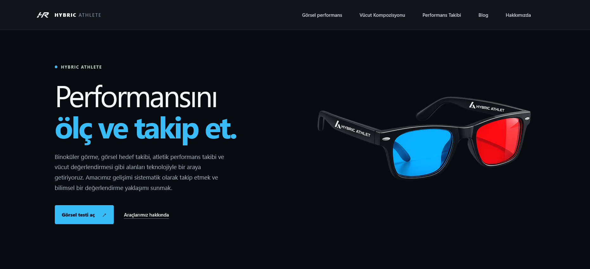
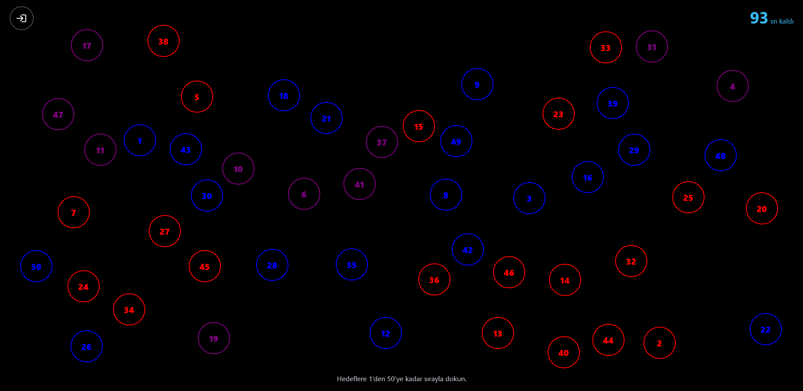
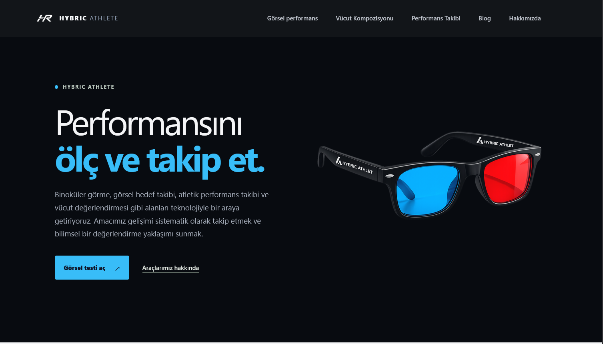
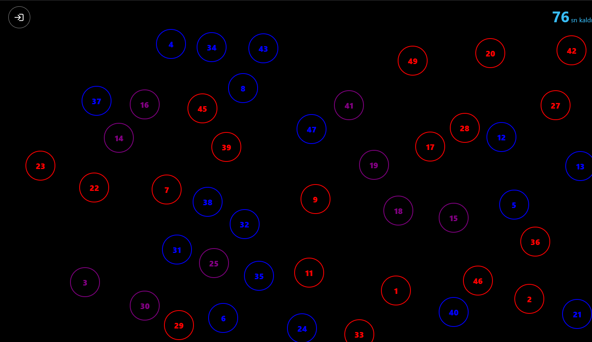
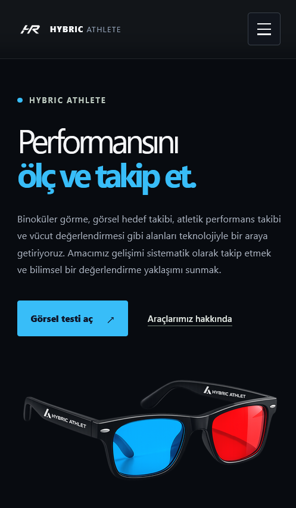
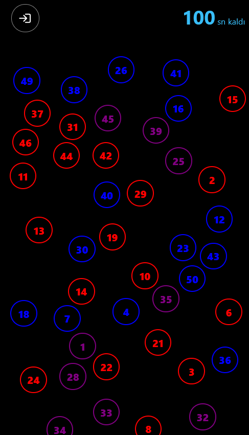

# Hybric Athlete

**Sporcu performansını ölçmek ve gelişimi takip etmek için dijital araçlar.**

🔗 **Canlı demo:** [athlete.hybric.tr](https://athlete.hybric.tr)

Hybric Athlete, elit sporcuların performans değerlendirmelerinde kullanılan binokülarite testini herkesin erişimine açma hedefiyle geliştirdiğim bir web projesi. Bu yaklaşımı görsel hedef takibi ve tepki süresi ölçümleriyle destekliyor; vücut değerlendirmesi aracını, kardiyo ve sprint takibini de aynı platformda sunuyor.
Amacım, sporcu performansını bilimsel yöntemlerden yararlanarak değerlendirmeye yönelik araçları daha geniş bir kitlenin erişimine açmak. Bu depo projenin tanıtım sayfası ve ekran görüntülerini içerir; uygulamanın kaynak kodu özel depoda tutulmaktadır.

## Ekran Görüntüleri

### Masaüstü

### Tablet

### Telefon

## Öne Çıkanlar

- Elit sporcuların performans değerlendirmelerinde kullanılan binokülarite testine dayalı görsel hedef takibi ve tepki süresi ölçümü.
- Vücut değerlendirme aracı
- Kardiyo ve sprint performansını kaydetme ve takip etme

## Teknoloji

- React
- Vite
- JavaScript

## Bağlantılar

- **Canlı site:** [https://athlete.hybric.tr](https://athlete.hybric.tr)
- **Proje sahibi:** [Fatih Keleş]
- **İletişim:** [iletisim@hybric.tr]

---

© 2026 Hybric. Tüm hakları saklıdır.
